# Блок-схеми задач П3

Позначення за ГОСТ 19.701-90: овал — початок/кінець, паралелограм — ввід/вивід, прямокутник — дія, ромб — умова, прямокутник з подвійними боковими лініями — виклик підпрограми. Пунктир — повернення на початок циклу. У кожної схеми **один** блок «Кінець».

### Задача 1. c_to_f(c)

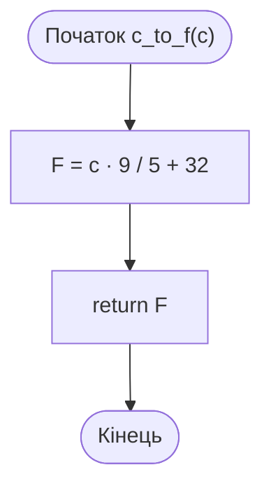

### Задача 2. triangle_area(a, h)

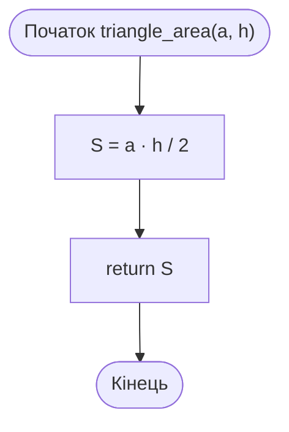

### Задача 3. min_max(a, b, c)

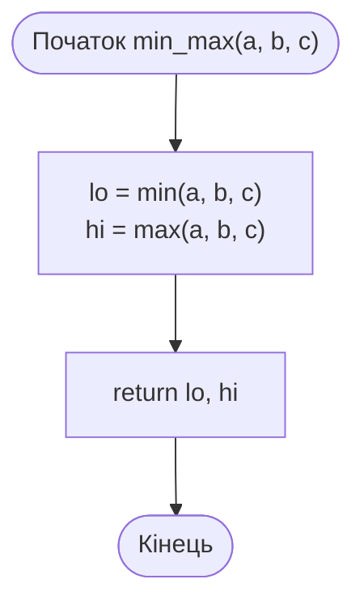

### Задача 4. is_prime(n)

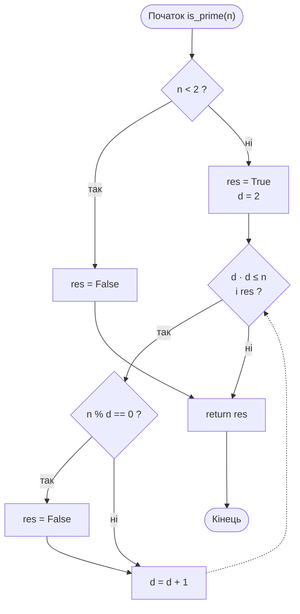

### Задача 4. primes_up_to(n) — процедура

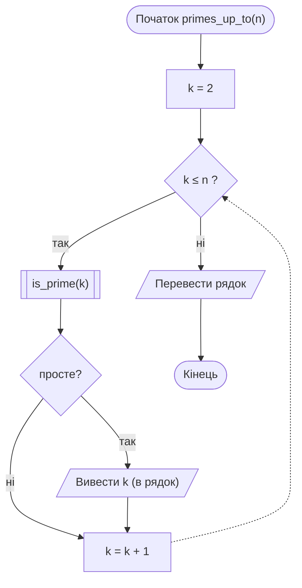

### Задача 5. print_box(width, symbol="*", height=3)

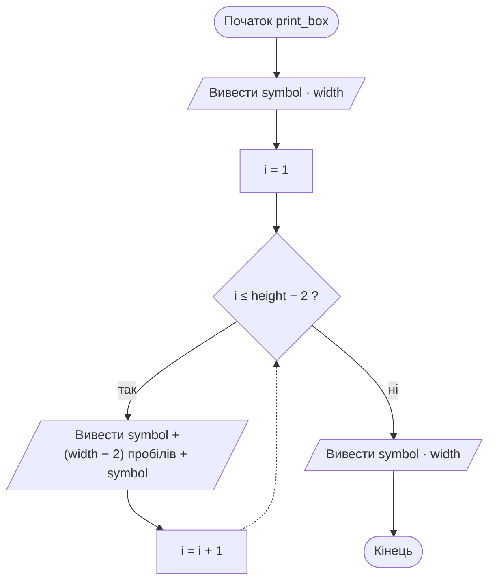

### Задача 6. factorial_rec(n)

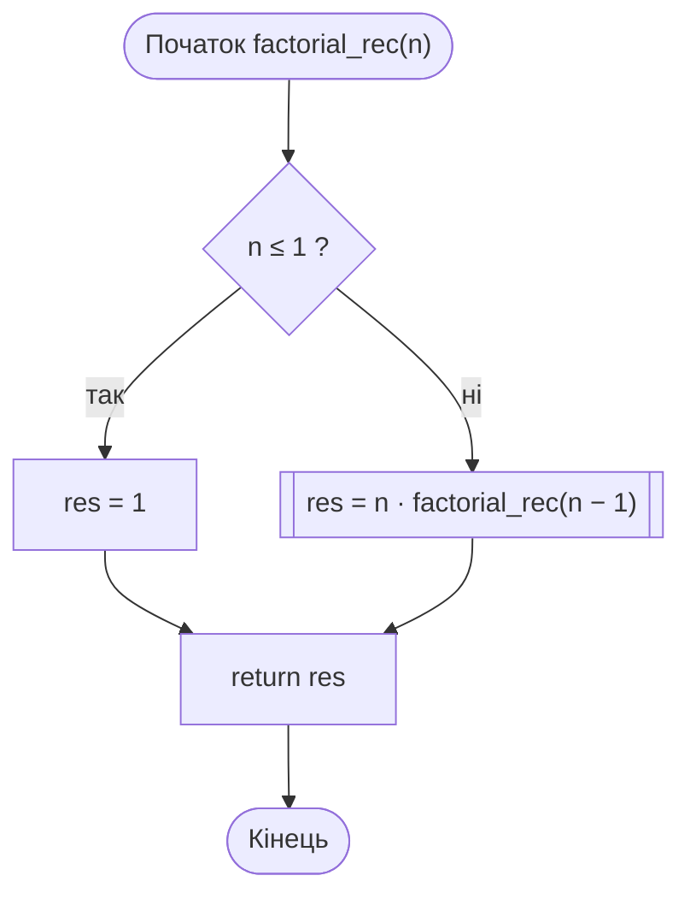

### Задача 6. fib_iter(n)

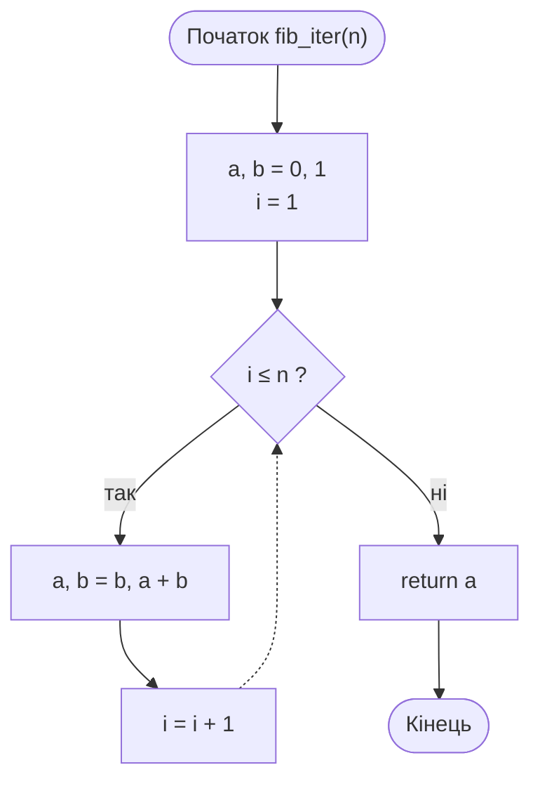

### Задача 7. gcd(a, b) — алгоритм Евкліда

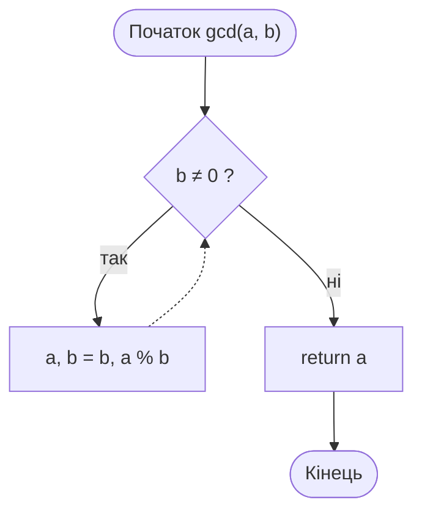

### Задача 7. reduce_fraction(num, den)

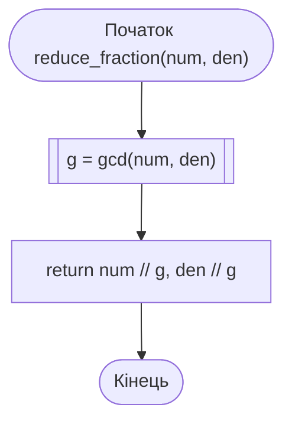

### Задача 8. digit_sum_rec(n)

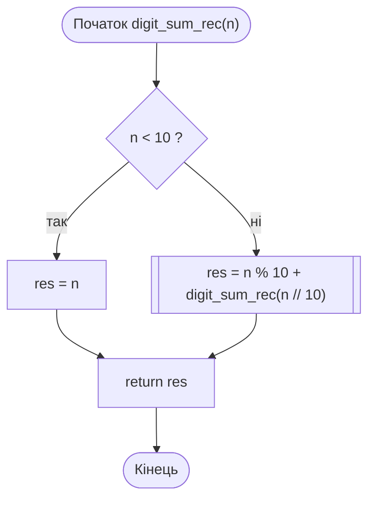

### Задача 8. reverse_number(n)

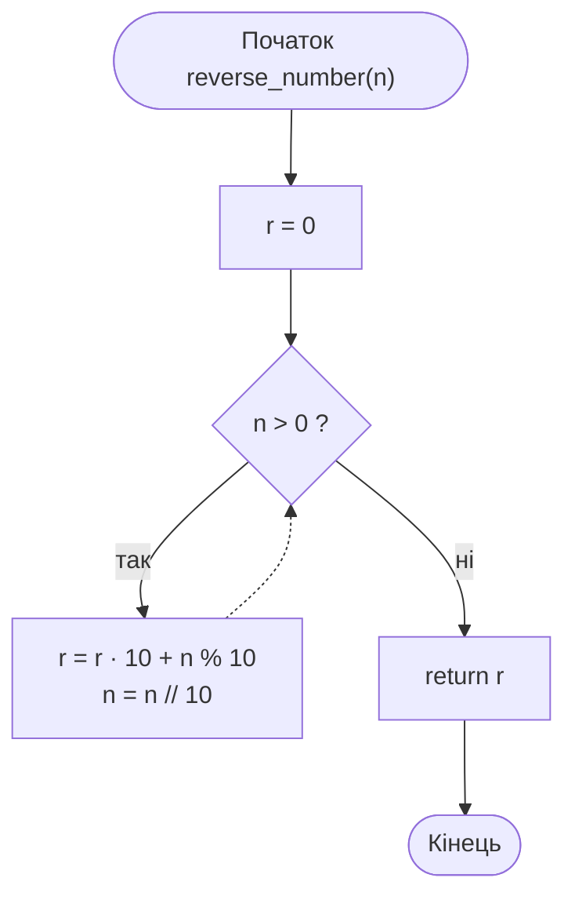

### Задача 9. main() — меню

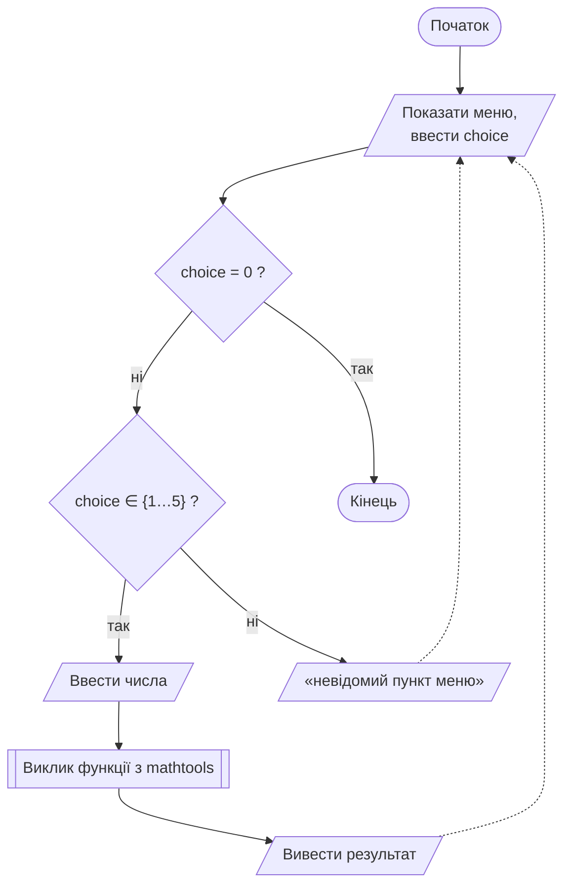
